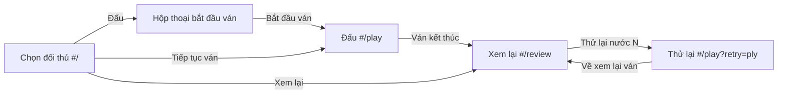

# Logic màn hình — MVP "Nước Hay" (tên tạm)

Prototype bấm được: `prototype/index.html` (chạy `cd prototype && python3 -m http.server 4173`).
Dữ liệu engine trong prototype là **thật** (Stockfish 19 lite, sinh bởi `tools/make-sample.mjs`);
lịch sử ván và thành tích là **mẫu** (`prototype/app-data.js`).

## 1. Luồng màn



Điều hướng chính chỉ có 2 đích: **Đấu** và **Xem lại**. Trên iPhone đây là thanh dưới, và thanh này ẩn khi đang đấu.

## 2. Quy tắc dùng chung

| Quy tắc | Giá trị |
|---|---|
| Điểm thế cờ | Tính theo tốt, **luôn theo góc nhìn người chơi** (dương = bạn hơn). Chiếu hết kẹp ±10 trên biểu đồ, chữ hiển thị `+M3`. |
| Winning chances | `wc(p) = 2 / (1 + e^(−0.368208·p)) − 1` (thang −1..1, công thức Lichess). |
| Xếp loại nước | Mức tụt wc của người đi: ≥ 0,3 **Lỗi lớn** (`??`), ≥ 0,2 **Sai lầm** (`?`), ≥ 0,1 **Chưa chính xác** (`?!`). Nước trùng nước máy chọn thì không xếp loại. |
| Ký hiệu nước | SAN đổi sang chữ Việt: V(ua) H(ậu) X(e) T(ượng) M(ã); tốt không có chữ. |
| Màu | Chrome không màu. Xanh `#1d5fbf` = lời coach / nước máy chọn. Đỏ = nước lỗi. Không dùng màu cho trang trí. |
| Lên cấp | Thắng ≥ 3 trong 5 ván gần nhất với boss đó thì boss tiếp theo được đề xuất. |

## 3. Màn Chọn đối thủ (`#/`)

**Câu hỏi:** Hôm nay đấu với ai? **Việc chính:** nút đen "Đấu với {boss đề xuất}".

| Khối | Logic |
|---|---|
| Dòng finding | `Bạn thắng {boss trước} {w}/{n} ván gần nhất. Với {boss đề xuất}, thắng thêm {3 − w'} ván nữa là lên cấp.` Tài khoản mới: `Chưa có ván nào. Bắt đầu với Tốt Nhỏ…` |
| Ván đang dở | Chỉ hiện khi có ván chưa kết thúc. Gồm thế cờ thu nhỏ, số nước, lượt và giờ lưu. Bấm "Tiếp tục ván" để mở `#/play`. |
| 4 boss | Boss đề xuất là boss thấp nhất chưa đạt luật lên cấp, có viền đen, nhãn "Nên đấu" và nút primary. Boss đã đạt luật có nhãn "Đã qua". Thành tích thắng/hòa/thua đếm từ lịch sử; số 0 in màu xám, boss chưa đấu ghi "Chưa đấu ván nào". |
| Ván gần đây | Hiện tối đa 5 dòng, kèm tổng số ván. Kết quả: Thắng (đậm), Hòa (xám), Thua (đỏ). Mỗi dòng có link "Xem lại". |
| Tiến độ lên cấp | Thanh thể hiện đúng tỉ lệ `thắng / 3`; boss chưa đấu hiện "—" và không có vạch. Cuối khối ghi "Đã mở k/4 boss". |
| Hộp thoại bắt đầu | Chọn quân (Trắng / Đen / Ngẫu nhiên) và công tắc **Nhắc khi sắp mắc lỗi lớn** (mặc định bật). Hai nút: "Để sau" và "Bắt đầu ván". |

Trạng thái rỗng: `#/?demo=empty`.

## 4. Màn Đấu (`#/play`)

**Câu hỏi:** Nên đi gì bây giờ? Khối lớn nhất là bàn cờ. Việc chính là đi quân trên bàn cờ; "Gợi ý" và "Đi lại" là nút phụ ở đáy màn, trong tầm ngón cái.

### Trạng thái

| Phase | Bàn cờ | Dòng coach | Nút |
|---|---|---|---|
| `loading` | Khóa | "Đang tải engine (1,8 MB)…" | Tắt |
| `error` | Khóa, ván giữ nguyên | "Không tải được engine. Bàn cờ vẫn lưu nguyên…" | "Tải lại engine" |
| `you` | Mở. Chạm quân để hiện chấm nước hợp lệ (vòng tròn nếu là nước ăn quân), chạm ô đích để đi. | "Lượt bạn. {boss} vừa đi {nước}." | Gợi ý, Đi lại |
| `alert` | Khóa. Mũi tên đỏ chỉ nước định đi; nước **chưa** được đi. | "Khoan đã: {nước} là lỗi lớn. {hậu quả}" | **Chọn nước khác** (primary), Vẫn đi |
| `thinking` | Khóa | "{boss} đang nghĩ…" | Tắt |
| `done` | Hiện nước boss đáp | "Bạn đi X. {boss} đáp Y." | Đi lại |

### Thang gợi ý (signature)

1. Bấm **Gợi ý** lần 1 → ô của quân nên đi có viền xanh. Coach nói "Gợi ý: tìm nước cho {quân} ở {ô}." Số gợi ý đã dùng tăng thêm 1.
2. Bấm **Xem nước gợi ý** → hiện mũi tên xanh, kèm câu "Nước máy chọn: X. {boss} có thể đáp Y."
3. Sau đó nút chuyển thành "Đã hiện gợi ý" và bị tắt. Đi một nước bất kỳ thì thang gợi ý quay về bậc 0.

Gợi ý không bao giờ tự đi thay người chơi.

### Nhắc lỗi lớn

- Chỉ áp dụng khi công tắc đang bật và đang ở chế độ đấu, không áp dụng khi thử lại.
- Trước khi gửi nước cho boss, so nước đó với danh sách nước đã phân tích. Nếu xếp loại là `loi-lon` thì chuyển sang phase `alert`.
- Câu "hậu quả" lấy từ nước đáp tốt nhất của đối thủ:
  - Nếu có chiếu hết: "có đòn chiếu hết sau n nước".
  - Nếu nước đáp ăn quân: "đáp Y và bắt {quân} của bạn".
  - Các trường hợp còn lại: "đáp Y, thế cờ còn ±x cho bạn".
- Công tắc nằm trong menu `⋯`. Menu này còn có lệnh "Bỏ ván này", phải xác nhận trước khi bỏ và ván được tính là thua.

### Đi lại

Đưa thế cờ về trước nước của bạn, gồm cả nước boss đã đáp. Thang gợi ý quay về bậc 0.

Các trạng thái demo: `#/play?demo=loading`, `#/play?demo=error`, `#/play?alert=0` (tắt nhắc lỗi).

## 5. Màn Xem lại (`#/review`)

**Câu hỏi:** Ván này hỏng ở đâu? **Việc chính:** "Thử lại nước N".

| Khối | Logic |
|---|---|
| Finding | `Thua sau {n} nước, bị chiếu hết. Lỗi đắt nhất: nước {k}, {SAN}, thế cờ từ {trước} xuống {sau}.` Lỗi đắt nhất là nước có mức tụt wc lớn nhất. |
| Ba khoảnh khắc | Lấy 3 nước **của người chơi** có mức tụt wc lớn nhất và đã được xếp loại, rồi xếp lại theo thứ tự trong ván. Mặc định chọn khoảnh khắc đắt nhất. |
| Bàn cờ khoảnh khắc | Hiện thế cờ **trước** nước lỗi: mũi tên đỏ là nước đã đi, mũi tên xanh là nước máy chọn. |
| Chi tiết | Pill xếp loại, mức đổi điểm `trước → sau`, câu hậu quả và nước tốt hơn kèm diễn biến dự kiến (4 nửa nước). |
| Đường thế cờ | Một đường duy nhất màu xanh, có vạch "Cân bằng" ở mức 0. Ba khoảnh khắc được đánh dấu bằng vạch dọc có nhãn. Trục y cố định −10..+10. |
| Lỗi trong ván | Đếm theo xếp loại cho bạn và cho boss. Số 0 in màu xám. |
| Các nước | Bấm vào một nước để xem thế cờ sau nước đó; nút ‹ › đi từng nửa nước. Ký hiệu `??` có màu đỏ, `?` và `?!` màu nâu. |

## 6. Thử lại (`#/play?retry={ply}`)

- Bắt đầu từ thế cờ trước nước lỗi. Tắt nhắc lỗi, vẫn cho dùng thang gợi ý.
- Sau khi người chơi đi, boss đáp bằng nước tốt nhất. Kết quả có 2 trường hợp:
  - **Không bị xếp loại**: "Đúng nước máy chọn" hoặc "Đúng hướng…". Kèm diễn biến máy dự kiến và hậu quả của nước đã đi trong ván. Nút: Về xem lại ván / Thử nước khác.
  - **Vẫn là lỗi**: "{nước} vẫn chưa ổn. {hậu quả}". Nút: Thử lại / Xem nước máy chọn.
- Ván gốc không bị sửa.

## 7. Từ prototype sang app thật

| Prototype | App thật |
|---|---|
| Tính trước mọi nước hợp lệ ở 4 thế cờ (depth 11–14, trên Mac) | Stockfish lite chạy trong Web Worker. Phân tích nước người chơi bằng `go movetime` có giới hạn. Huỷ kết quả cũ khi đi lại hoặc đổi ván. |
| Boss đáp bằng nước tốt nhất đã tính sẵn | Boss có cấu hình riêng cho từng mức. Từ 1.320 Elo trở lên dùng `UCI_LimitStrength` + `UCI_Elo` (Stockfish 19 lite không cho đặt thấp hơn 1.320). Tốt Nhỏ 600 và Mã Non 1.000 dùng `Skill Level` thấp và **phải hiệu chỉnh bằng ván thử**. |
| Mọi boss đều mở ván mẫu với Mã Non | Tạo ván mới theo boss và màu quân đã chọn. Màu "Ngẫu nhiên" được bốc ngay khi tạo ván. |
| Phong cấp luôn thành hậu | Hiện bảng chọn 4 quân. |
| Lịch sử ván lấy từ `app-data.js` | Lưu vào IndexedDB sau mỗi nước, bao gồm nước đã đi, số gợi ý đã dùng và trạng thái nhắc lỗi. |

Kiểu dữ liệu gợi ý (TypeScript):

```ts
type Color = 'w' | 'b';
type Judgement = 'loi-lon' | 'sai-lam' | 'chua-chinh-xac' | null;
interface Boss { id: string; name: string; elo: number; engine: { skill?: number; uciElo?: number; movetimeMs: number } }
interface Game { id: string; bossId: string; color: Color; sans: string[]; result: 'win' | 'draw' | 'loss' | null; hintsUsed: number; alert: boolean; updatedAt: string }
interface PlyAnalysis { san: string; evalAfter: number; mateAfter: number | null; bestSan: string; bestLine: string[]; drop: number; judgement: Judgement }
```

## 8. App thật (`app/`): đánh giá nước thay cho nhắc lỗi

Theo yêu cầu sau khi chơi thử: **không chặn nước**. Nước đi được thực hiện ngay, rồi được chấm và hiện kết quả.

| Bước | Logic |
|---|---|
| Mốc "trước nước" | Lấy từ phân tích gợi ý (`movetime 1500`). Khi người chơi đi, phân tích này dừng ngay và dùng kết quả đang có. |
| Chấm nước | Thế cờ sau nước nằm trong sách khai cuộc (lichess-org/chess-openings, CC0, 3.865 biến, 7.982 thế cờ): **Nước sách** kèm tên khai cuộc, không cần engine. Trùng nước máy chọn: **Nước tốt nhất ★**. Còn lại thì phân tích thế cờ sau nước (`movetime 400`) rồi `classify()`: độ tụt wc < 0,04 là **Rất tốt ✓**; < 0,1 là **Tốt ✓**; từ 0,1 là **Chưa chính xác ?!**; từ 0,2 là **Sai lầm ?**; từ 0,3 là **Lỗi lớn ??**. |
| Xuất sắc !! | Nước tốt nhất hoặc rất tốt **và** là thí quân, khi điểm trước nước < +4 và sau nước ≥ −0,5. `isSacrifice()` đi theo biến chính của engine tới thế cờ "yên" đầu tiên sau khi đối thủ đáp (nước không ăn quân, không chiếu, trong 6 nửa nước). Nếu lúc đó người chơi thiếu ≥ 2 điểm quân thì là thí quân. Giới hạn: không bắt được trường hợp đối thủ từ chối ăn quân thí, và không có loại "Great !" (nước duy nhất). |
| Hiển thị | Huy hiệu tròn ở góc trên phải ô đích. Ẩn huy hiệu nếu boss vừa ăn quân ở ô đó. Dòng coach ghi tên loại; với nước kém thì thêm câu hậu quả và "Nước tốt hơn: X". Nước kém có ký hiệu `?!` `?` `??` trong danh sách nước. |
| Thanh cơ hội thắng | Thanh mờ bên trái bàn cờ, phần sáng ở dưới là phần của bạn: `(wc + 1) / 2`. Cập nhật sau khi chấm nước và sau mỗi lần phân tích gợi ý. Dòng của người chơi ghi "Cơ hội thắng N%". |
| Thứ tự engine | Chấm nước (≤ 400 ms) chạy trước, rồi mới tới boss. Thời gian chấm được tính vào độ trễ tối thiểu của boss. |

## 9. Mốc 2: hoàn thiện ván đấu

| Phần | Logic |
|---|---|
| Lưu ván | `localStorage['nuoc-hay:game']` = boss, màu quân, các nước SAN, đánh giá từng nước và câu kết thúc. Lưu sau mỗi thay đổi. Khi mở app, ván được dựng lại bằng chess.js; dữ liệu hỏng hoặc có nước sai thì bỏ, tạo ván mới. |
| Cầm Đen | Bàn cờ lật ngược, boss đi trước. Thanh cơ hội thắng tô phần dưới bằng màu quân của bạn. "Đi lại" lùi về lượt bạn; nếu lùi về đầu ván thì boss đi lại nước đầu. |
| Ván mới | Mở từ menu `⋯` hoặc khi ván kết thúc. Chọn Trắng / Đen / Ngẫu nhiên; màu "Ngẫu nhiên" được bốc ngay khi bắt đầu. Nếu đang có ván dở thì báo trước "Ván đang chơi sẽ bị xóa". |
| Phong cấp | Chạm vào ô phong cấp thì hiện bảng 4 quân (hậu, xe, tượng, mã) và nút Hủy. |

## 10. Mốc 3: màn Chọn đối thủ và lịch sử ván

| Phần | Logic |
|---|---|
| Điều hướng | `#/` là màn Chọn đối thủ, `#/play` là ván đang chơi (nếu chưa có ván thì quay về `#/`), `#/bench` là trang đo. Nút `‹` trên màn Đấu quay về màn Chọn đối thủ; "Đo engine" nằm trong menu `⋯`. |
| Ván dở | Tại một thời điểm chỉ có một ván dở, lưu trong `localStorage`. Chọn boss khác khi đang có ván dở thì hộp thoại báo trước "Ván dở với X sẽ bị xóa, không tính thắng thua". |
| Lịch sử | Khi ván kết thúc (chiếu hết, hòa hoặc bỏ ván), ván được ghi vào IndexedDB `nuoc-hay/games`, gồm kết quả, lý do, các nước và đánh giá từng nước (dùng cho màn Xem lại ở Mốc 4). Mỗi ván có một id; ghi lại cùng id thì ghi đè (ví dụ khi đi lại sau khi ván đã kết thúc). |
| Thành tích, đề xuất | Tính từ lịch sử: thắng/hòa/thua theo boss. Boss đề xuất là boss thấp nhất chưa thắng 3 trong 5 ván gần nhất. Tiến độ lên cấp hiện đúng tỉ lệ số ván thắng / 3. |
